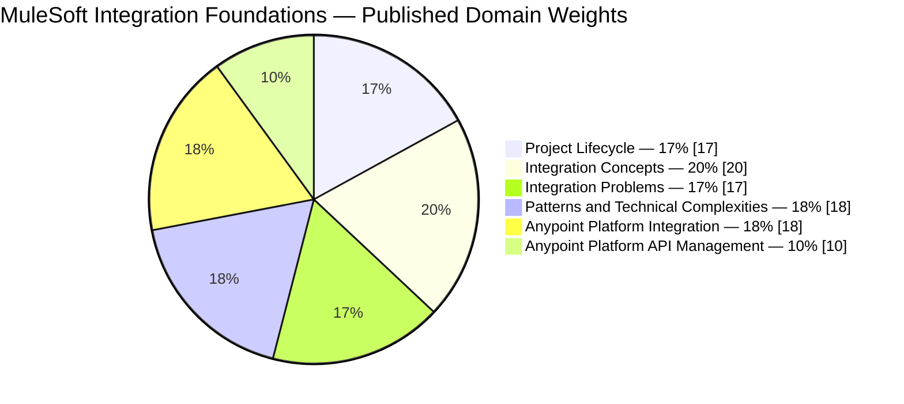
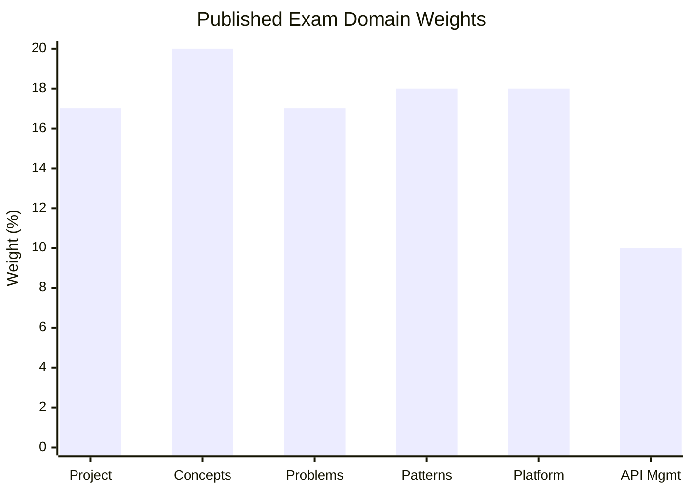
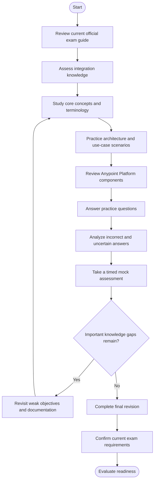
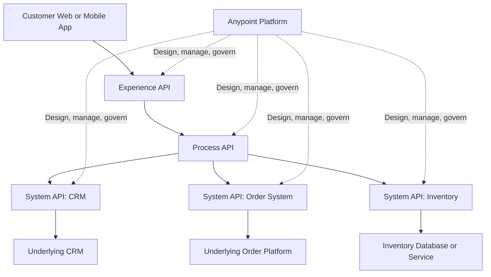
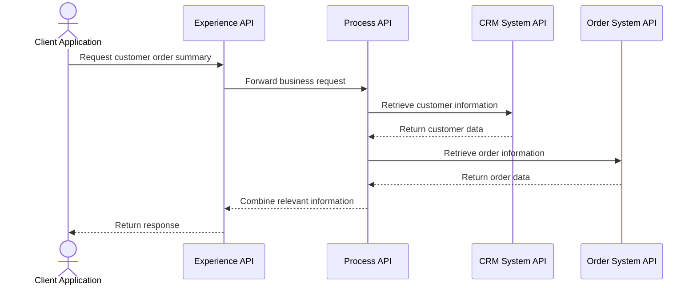
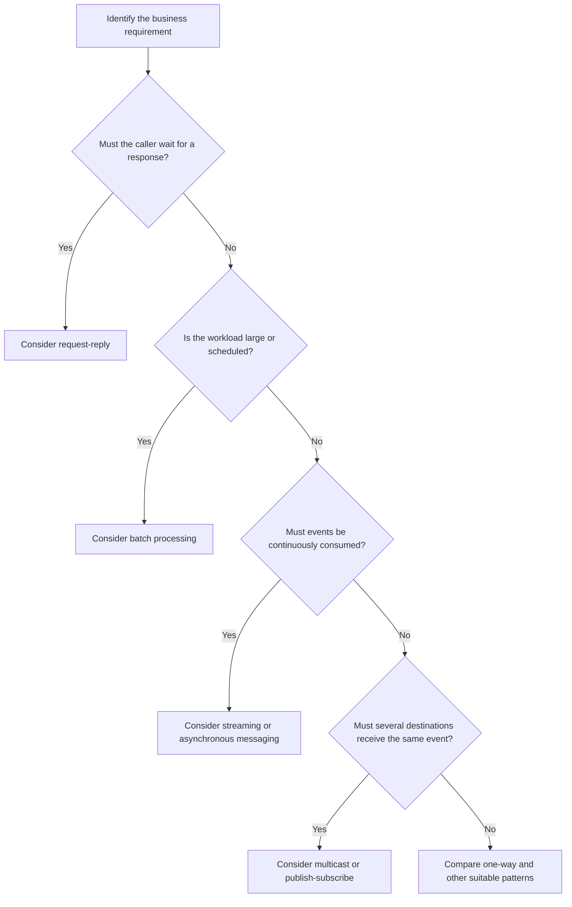
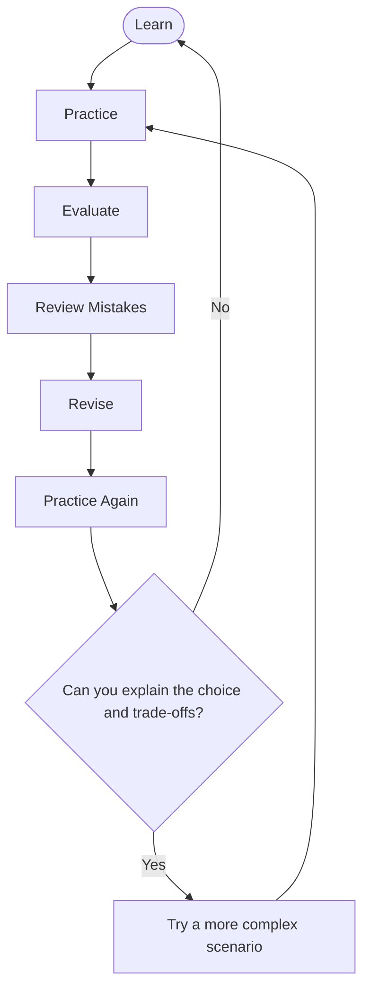
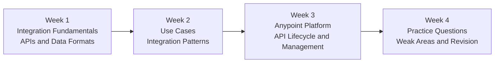

# Salesforce Certified MuleSoft Integration Foundations — Study Guide

A practical study resource for understanding enterprise integration, API-led connectivity, and the role of MuleSoft Anypoint Platform in connecting applications and systems.

This repository brings together exam-objective summaries, technical diagrams, realistic integration scenarios, original practice questions, and links to official Salesforce learning resources. It is intended for learners who want to understand integration concepts and make informed technical decisions rather than memorize answers.

> **Exam information notice:** The published Salesforce exam guide referenced here aligns to the Spring ’24 release. Confirm the current exam guide, registration availability, and policies with Salesforce before scheduling an exam.

For supplementary preparation material, visit [CertsGate — Mule-101](https://certsgate.com/exams/salesforce/mule-101).

---

## Table of Contents

- [Overview](#overview)
- [About the Certification](#about-the-certification)
- [Who Should Prepare?](#who-should-prepare)
- [Core Integration Concepts](#core-integration-concepts)
- [Official Exam Objectives](#official-exam-objectives)
- [Exam Domain Weightage](#exam-domain-weightage)
- [Certification Preparation Flowchart](#certification-preparation-flowchart)
- [API-Led Connectivity Architecture](#api-led-connectivity-architecture)
- [Integration Request Sequence](#integration-request-sequence)
- [Choosing an Integration Pattern](#choosing-an-integration-pattern)
- [Circular Study and Revision Cycle](#circular-study-and-revision-cycle)
- [Step-by-Step Preparation Guide](#step-by-step-preparation-guide)
- [Four-Week Study Roadmap](#four-week-study-roadmap)
- [Hands-On Practice Projects](#hands-on-practice-projects)
- [Original Practice Questions](#original-practice-questions)
- [Reviewing Mistakes and Assessing Readiness](#reviewing-mistakes-and-assessing-readiness)
- [Common Preparation Mistakes](#common-preparation-mistakes)
- [Career Relevance](#career-relevance)
- [Frequently Asked Questions](#frequently-asked-questions)
- [Official and Additional Resources](#official-and-additional-resources)
- [About CertsGate](#about-certsgate)

---

## Overview

Organizations rarely keep all their business information in one system. Customer records, orders, inventory, finance, and support data may live in separate applications, databases, and cloud services. Integration connects these systems so information can move between them in a controlled and useful way.

MuleSoft provides tools for building and managing integrations and APIs. Anypoint Platform supports activities across the API lifecycle, from design and development to deployment, management, and governance.

The **Salesforce Certified MuleSoft Integration Foundations** certification focuses on foundational knowledge of integration projects, API concepts, common architectural patterns, and the capabilities of Anypoint Platform. It is suitable for people who want to contribute to MuleSoft projects, including those who are not yet full-time integration developers.

This guide covers six central areas:

- Integration project roles and lifecycle.
- APIs, networking, data formats, and cloud concepts.
- Common enterprise integration problems and solutions.
- Integration patterns and technical trade-offs.
- Anypoint Platform components and deployment options.
- API management and API-led connectivity.

## About the Certification

The Salesforce Certified MuleSoft Integration Foundations credential is designed for people who understand core integration terminology and want to work as informed members of MuleSoft project teams.

According to Salesforce, the intended audience can include developers, architects, project managers, technical project managers, integration product owners, IT professionals, and IT operations staff.

Official credential information: [Salesforce Certified MuleSoft Integration Foundations](https://trailhead.salesforce.com/credentials/integrationfoundations).

### Published exam information

The Salesforce exam guide aligned to Spring ’24 lists the following details.

| Detail | Published guide information |
|---|---|
| Certification | Salesforce Certified MuleSoft Integration Foundations |
| Provider | Salesforce |
| Question format | Multiple-choice |
| Question count | 40 scored questions, plus up to 5 unscored questions |
| Time limit | 70 minutes |
| Passing score | 70% |
| Delivery | Proctored, onsite or online |
| Reference materials | Not permitted during the exam |
| Prerequisite | None listed |
| Guide version | Spring ’24 |
| Published registration fee | US$75, plus applicable taxes; verify current pricing |

These details are from the published exam guide and may change. Check the current Salesforce exam information before registering.

Official reference: [Salesforce MuleSoft Integration Foundations Exam Guide](https://help.salesforce.com/s/articleView?id=005298961&language=en_US&type=1).

## Who Should Prepare?

This certification may be useful for:

- IT professionals learning enterprise integration.
- Developers beginning their MuleSoft journey.
- Architects who need foundational API and integration terminology.
- Project managers working with integration delivery teams.
- Product owners coordinating API and integration requirements.
- Operations professionals supporting connected applications.
- Business and technical stakeholders involved in integration projects.

You do not need to be an advanced Mule application developer to start learning these concepts. However, basic familiarity with applications, web communication, data formats, and cloud services will make the material easier to understand.

The goal is to recognize integration problems, understand the available approaches, and explain why a particular technology or pattern may fit a business requirement.

---

## Core Integration Concepts

### 1. What is system integration?

System integration allows separate applications or services to exchange data and coordinate business activities.

For example, when a customer places an order, the order system might need to communicate with inventory, payment, shipping, and customer notification systems. Integration connects those capabilities without requiring every application to understand the internal implementation of every other system.

Common integration requirements include:

- Moving data between systems.
- Synchronizing records.
- Combining information from several sources.
- Triggering actions when events occur.
- Exposing reusable business capabilities through APIs.
- Managing failures and inconsistent responses.

### 2. API-led connectivity

API-led connectivity organizes integration around reusable APIs and clearly defined responsibilities.

A commonly used model separates APIs into three layers:

| Layer | Main responsibility | Example |
|---|---|---|
| System APIs | Provide controlled access to underlying systems | Retrieve customer records from a CRM |
| Process APIs | Combine or orchestrate business processes and data | Combine customer and order information |
| Experience APIs | Shape capabilities for a particular consumer or channel | Provide order information for a mobile application |

This is an architectural approach, not a rule that every integration must contain exactly three APIs.

The design should reflect the business requirements, reuse opportunities, security needs, and operational constraints.

### 3. REST, SOAP, GraphQL, and AsyncAPI

Different API styles address different needs.

| API technology | Key idea | Useful knowledge |
|---|---|---|
| REST | Uses resources and HTTP methods to expose operations | Resources, methods, status codes, headers, parameters |
| SOAP | Uses structured XML messaging and defined service contracts | Envelopes, operations, XML, service descriptions |
| GraphQL | Allows clients to request specific fields through a query model | Queries, mutations, schemas, selected fields |
| AsyncAPI | Describes event-driven and message-based APIs | Channels, messages, operations, asynchronous communication |

These technologies are not interchangeable. Learn what each describes and which communication requirements it can support.

### 4. Cloud service models

Understand the differences between the common cloud service models.

- **Infrastructure as a Service (IaaS):** Provides infrastructure resources such as virtual machines, networking, and storage.
- **Platform as a Service (PaaS):** Provides a managed platform for building and running applications.
- **Software as a Service (SaaS):** Provides a ready-to-use application delivered as a service.

Also study cloud, hybrid, and on-premises deployment models. A solution may use several environments depending on data residency, connectivity, operational control, and business requirements.

### 5. Integration patterns

Integration patterns describe how components communicate and coordinate work.

Common patterns include:

- Request-reply.
- One-way messaging.
- Multicast.
- Batch processing.
- Streaming.
- Aggregation.
- Orchestration.
- Choreography.

Understanding the trade-offs matters more than memorizing the names. Consider response-time requirements, data volume, ordering, failure handling, and how tightly systems should depend on one another.

### 6. Anypoint Platform

Anypoint Platform provides tools and services for designing, building, managing, and governing APIs and integrations.

Foundational topics include:

- API design and specifications.
- Anypoint Studio and Mule applications.
- Anypoint Exchange and reusable assets.
- Connectors for applications, databases, and protocols.
- API management and policies.
- Runtime and control plane concepts.
- Deployment options.
- Development and DevOps tooling.

Learn the purpose of each component and how it contributes to an integration lifecycle.

---

## Official Exam Objectives

The published Salesforce MuleSoft Integration Foundations exam guide lists six domains. The following table summarizes their scope.

| Domain | Weight | Main areas to study |
|---|---:|---|
| Roles, Responsibilities, and Integration Project Lifecycle | 17% | Project roles, delivery methodologies, DevOps, API lifecycle, IT delivery gap |
| Essential Integration Concepts and Terminology | 20% | Cloud models, infrastructure, protocols, data formats, API terminology, security fundamentals |
| Common Integration Problems, Use Cases, and Technical Solutions | 17% | Enterprise systems, legacy and modern integration, use cases, integration technologies |
| Technical Complexities and Integration Patterns | 18% | Interaction and composition patterns, design-first APIs, observability, connectors, deployment architectures |
| Anypoint Platform for System Integration | 18% | Platform components, connectors, runtime and control planes, deployment, development tools, Exchange |
| Anypoint Platform for API Management | 10% | API lifecycle, API management components, Universal API Management, API-led connectivity |

For the complete objective wording, use the [official Salesforce exam guide](https://help.salesforce.com/s/articleView?id=005298961&language=en_US&type=1).

## Exam Domain Weightage

The chart below uses the percentages published in the Spring ’24-aligned guide. The six domains total 100%.

### Domain distribution

### Compare the domain weights

Integration concepts has the largest published weight at 20%. The other four major technical and lifecycle domains are weighted between 17% and 18%, while API management is listed at 10%.

Use these figures as a study-planning reference only. Verify the current exam guide before taking an exam.

---

## Certification Preparation Flowchart

This workflow turns the official exam objectives into a repeatable preparation process.

The decision point is important. If you cannot explain why an integration pattern fits a scenario, revisit the concept before moving on.

## API-Led Connectivity Architecture

The following is an illustrative architecture showing how a business application might use API-led connectivity. It is a conceptual learning diagram, not a mandatory design for every MuleSoft implementation.

### How to interpret the architecture

- **Experience API:** Presents data and capabilities for a particular consumer.
- **Process API:** Combines data or coordinates a business process.
- **System API:** Provides a controlled interface to an underlying system.
- **Anypoint Platform:** Supports API lifecycle activities and integration management.

This model can improve reuse and separation of responsibilities when applied appropriately. It does not mean every project needs a separate API at each layer.

## Integration Request Sequence

A simplified request-reply scenario helps explain how APIs and backend systems can cooperate.

This example illustrates request-reply communication and data aggregation. Actual implementations may use different APIs, connectors, security controls, and failure-handling strategies.

When evaluating such a solution, ask what should happen if one backend is unavailable, whether partial results are acceptable, and how errors should be communicated to the client.

## Choosing an Integration Pattern

Different interaction patterns suit different requirements. This decision tree is an independent study aid, not a formal Salesforce decision framework.

Before selecting a pattern, consider:

- How quickly the caller needs a result.
- The volume and frequency of messages.
- Whether processing must be ordered.
- What happens when a destination is unavailable.
- Whether duplicate messages are possible.
- Whether the solution needs aggregation or orchestration.
- How the integration will be monitored.

---

## Circular Study and Revision Cycle

Preparation is iterative. Learn a concept, test it, review mistakes, and repeat until you can explain the reasoning in a new scenario.

For example, after missing a question about request-reply and one-way messaging, compare their behavior, identify which requirements matter, and explain what happens if a downstream system is unavailable.

## Step-by-Step Preparation Guide

### Step 1: Read the official exam guide

Start with the [Salesforce MuleSoft Integration Foundations Exam Guide](https://help.salesforce.com/s/articleView?id=005298961&language=en_US&type=1).

Create a checklist of all six domains. Confirm that the guide is appropriate for the exam version you intend to take.

### Step 2: Learn integration terminology

Build a glossary for APIs, consumers, implementations, proxies, protocols, data formats, cloud service models, and deployment architectures.

For every term, write a short definition and one practical example. This will help you distinguish concepts that sound similar but serve different purposes.

### Step 3: Understand the API lifecycle

Review how APIs are designed, implemented, deployed, managed, and governed.

Learn why design-first development can help teams agree on an API contract before implementation begins. Understand how versioning, documentation, reuse, and governance contribute to maintainable API ecosystems.

### Step 4: Compare integration technologies

Practice matching technologies to business requirements.

For example, a scheduled transfer of a large number of records may call for a different approach from an interactive request that needs an immediate response.

For each scenario, identify:

1. The systems involved.
2. The required data movement.
3. The expected response behavior.
4. The appropriate interaction or composition pattern.
5. The likely failure and monitoring requirements.

### Step 5: Study Anypoint Platform

Identify the role of the main platform components and how they support integration development and API management.

Focus on what each component does, how it fits into the lifecycle, and when a team might use it. Use current Salesforce documentation when terminology or product capabilities are unclear.

### Step 6: Review security and observability

Understand the fundamentals of API and enterprise system security. Review why authentication, authorization, secure communication, and appropriate access controls matter.

Also learn the differences between:

- **Logs:** Detailed records of events.
- **Metrics:** Numerical measurements of system behavior.
- **Traces:** Information that follows a request across components.

These observability methods provide different but complementary views of an integration.

### Step 7: Use practice questions to find gaps

Answer scenario-based questions and explain why each answer fits the requirement.

Map every mistake to an official objective. Review the relevant material and test the concept with a different example.

You can also use [CertsGate Mule-101 preparation resources](https://certsgate.com/exams/salesforce/mule-101) as supplementary practice. Verify technical details and exam policies against official Salesforce sources.

---

## Four-Week Study Roadmap

This is an independent example schedule, not an official preparation-time recommendation. Adjust it to your background and available study time.

| Week | Focus | Practical outcome |
|---|---|---|
| 1 | API terminology, REST, SOAP, GraphQL, AsyncAPI, protocols, cloud models | Explain the purpose and differences of key concepts |
| 2 | Integration use cases, legacy and modern approaches, interaction and composition patterns | Select and justify a suitable pattern for a scenario |
| 3 | Anypoint Platform, connectors, API lifecycle, governance, runtime and control planes | Explain how the platform supports integration and API management |
| 4 | Scenario questions, domain review, mock assessments, weak areas | Identify gaps and explain technical decisions confidently |

### Suggested study routine

1. Review one exam objective.
2. Read the relevant official documentation or Trailhead material.
3. Draw a small diagram for the concept.
4. Apply it to a business scenario.
5. Answer related practice questions.
6. Record incorrect answers and revisit the underlying concepts.

A short, consistent routine with feedback is more useful than completing many questions without understanding the explanations.

---

## Hands-On Practice Projects

The following projects are independent learning exercises, not official Salesforce exam tasks. They focus on foundational reasoning rather than requiring a production MuleSoft environment.

### Project 1: Design a Customer Information API

**Scenario:** A business needs to expose customer information to a web application without allowing the client to access the underlying database directly.

Tasks:

- Identify the API consumer and business requirement.
- Define the resource and expected response.
- Choose suitable HTTP methods.
- Identify relevant request parameters and response codes.
- Draw a conceptual API-led architecture.
- List authentication, authorization, and data-access considerations.

**Learning goal:** Understand API resources, interfaces, consumers, and the relationship between an API and its implementation.

### Project 2: Choose a Pattern for Order Processing

**Scenario:** An order service must send information to inventory and customer notification systems.

Tasks:

- Identify which actions require an immediate response.
- Decide which actions can happen asynchronously.
- Consider whether the same event must reach multiple destinations.
- Explain what happens if one destination is unavailable.
- Compare request-reply, one-way, and multicast approaches.
- Document the trade-offs of your chosen design.

**Learning goal:** Apply interaction patterns to a realistic integration requirement.

### Project 3: Compare Cloud and Hybrid Architectures

**Scenario:** A company wants to integrate a cloud CRM with an internal inventory system.

Tasks:

- Identify the systems and their hosting locations.
- Compare a cloud-hosted approach with a hybrid deployment.
- List connectivity and operational requirements.
- Identify security and network considerations.
- Explain how the integration should be monitored.
- Document the reasons for your preferred approach.

**Learning goal:** Understand deployment architecture and the trade-offs between cloud, hybrid, and on-premises systems.

### Project 4: Plan an API Lifecycle

**Scenario:** A team is developing an API that will be consumed by multiple applications.

Tasks:

- Write a short API requirement.
- Draft a simple API contract.
- Identify design, implementation, testing, deployment, and management activities.
- Describe how versions and changes will be communicated.
- Identify reusable assets and documentation.
- Explain how the API will be monitored and governed.

**Learning goal:** Understand API lifecycle management and the benefits of design-first development.

### Project 5: Create an Integration Troubleshooting Plan

**Scenario:** A business process sometimes fails when communicating with a downstream system.

Tasks:

- Identify the components involved in the request.
- List possible failure points.
- Explain which logs, metrics, and traces could help.
- Describe how the team would identify the source of the failure.
- Consider retries, timeouts, and partial results where appropriate.
- Document how the issue would be communicated to stakeholders.

**Learning goal:** Connect integration patterns, observability, and practical troubleshooting.

---

## Original Practice Questions

The questions below are original educational exercises for this repository. They are not official Salesforce exam questions.

### Question 1: API Terminology

A mobile application calls an endpoint that retrieves customer information from a backend system. What is the mobile application in this interaction?

A. API consumer  
B. API implementation  
C. Runtime plane  
D. Data format  

**Answer: A**

**Explanation:** The mobile application consumes the API. The API implementation provides the behavior behind the interface.

### Question 2: API-Led Connectivity

A team wants to expose controlled access to a CRM system so several business processes can reuse it. Which API layer is most directly associated with providing access to the underlying system?

A. Experience API  
B. System API  
C. User interface API  
D. Dashboard API  

**Answer: B**

**Explanation:** A System API commonly provides a controlled interface to an underlying system. The exact design depends on the integration requirements.

### Question 3: Integration Patterns

A process must call a service and use its response before continuing. Which interaction pattern most directly fits this requirement?

A. Request-reply  
B. One-way messaging  
C. Batch processing  
D. Unrelated event broadcasting  

**Answer: A**

**Explanation:** Request-reply is appropriate when the caller needs a response to continue its work. Other patterns may be suitable when the response is not needed immediately.

### Question 4: API Design

Why might a team use a design-first API approach?

A. To eliminate the need for testing  
B. To avoid documenting API behavior  
C. To agree on the API contract before implementing it  
D. To guarantee that no changes will be required  

**Answer: C**

**Explanation:** Design-first development lets stakeholders and consumers review the interface before implementation. It can improve alignment but does not remove the need for testing or future changes.

### Question 5: Observability

Which option best describes a trace?

A. A record of every configuration file  
B. A numerical measurement of CPU usage only  
C. Information that follows a request across components  
D. A list of all API consumers  

**Answer: C**

**Explanation:** Traces help connect activity across services and components. Logs and metrics provide different, complementary information.

### Question 6: Cloud Service Models

A provider offers a complete application that users access over the internet without managing the underlying infrastructure. Which service model does this most closely represent?

A. IaaS  
B. SaaS  
C. On-premises hosting  
D. Network virtualization only  

**Answer: B**

**Explanation:** Software as a Service delivers a ready-to-use application. IaaS primarily provides infrastructure resources, while PaaS provides a managed application platform.

### Question 7: API Management

A team needs to govern APIs throughout their lifecycle rather than manage only the code that implements them. Which approach is most relevant?

A. API lifecycle management  
B. Manual file copying only  
C. Removing API documentation  
D. Avoiding version control  

**Answer: A**

**Explanation:** API lifecycle management covers activities such as design, implementation, deployment, management, and governance.

### Question 8: Effective Preparation

You repeatedly answer questions about integration patterns incorrectly. What should you do next?

A. Memorize answer letters  
B. Skip the topic  
C. Review the relevant concepts, compare use cases, and explain the trade-offs  
D. Take more tests without reviewing the mistakes  

**Answer: C**

**Explanation:** Understanding why a pattern fits a requirement helps you apply the concept to unfamiliar scenarios.

---

## Reviewing Mistakes and Assessing Readiness

Practice questions help identify weak areas, but only if you review the reasoning behind each answer.

Use this process after every practice session:

1. **Answer:** Choose an option and record your reasoning.
2. **Review:** Read the explanation and consult the relevant documentation.
3. **Understand:** Explain why the correct answer fits the scenario.
4. **Identify the gap:** Map the mistake to an exam domain.
5. **Revisit:** Study the concept and draw or work through a new example.
6. **Try again:** Answer a different question that tests the same principle.

### Example error log

| Domain | Mistake | Follow-up action |
|---|---|---|
| Project lifecycle | Confused API design with implementation | Review the API lifecycle and delivery roles |
| Integration concepts | Mixed up REST and SOAP | Compare their communication models and common use cases |
| Integration solutions | Chose a synchronous pattern for an asynchronous requirement | Revisit interaction patterns and response requirements |
| Technical patterns | Confused orchestration with choreography | Compare centralized coordination with distributed event coordination |
| Anypoint Platform | Could not explain a component's role | Review the official platform documentation |
| API management | Focused only on code implementation | Study lifecycle management, governance, and API policies |

Review questions you answered correctly by guessing, too. A lucky answer does not necessarily indicate that you understand the concept.

### Readiness checklist

Before deciding you are ready, check whether you can:

- [ ] Explain the six exam domains.
- [ ] Describe the roles in an integration project.
- [ ] Distinguish API consumers, interfaces, implementations, and proxies.
- [ ] Compare REST, SOAP, GraphQL, and AsyncAPI at a foundational level.
- [ ] Explain the differences between IaaS, PaaS, and SaaS.
- [ ] Select and justify common integration patterns.
- [ ] Describe the main components and benefits of Anypoint Platform.
- [ ] Explain the purpose of API lifecycle management.
- [ ] Distinguish logs, metrics, and traces.
- [ ] Explain why an incorrect option does not meet a business requirement.
- [ ] Verify current exam requirements through Salesforce.

This is an independent self-assessment checklist, not an official passing standard.

---

## Common Preparation Mistakes

### Memorizing definitions without applying them

Learn how concepts behave in business scenarios. Being able to distinguish request-reply from one-way messaging is more useful when you can explain why one fits a requirement.

### Treating every API technology as interchangeable

REST, SOAP, GraphQL, and AsyncAPI have different models and purposes. Understand the differences before choosing a solution.

### Ignoring integration failure scenarios

A design must account for timeouts, unavailable systems, invalid data, and incomplete responses where relevant. Consider how failures affect the overall business process.

### Confusing API-led connectivity with a mandatory three-API design

System, Process, and Experience APIs are useful architectural concepts, but a solution should reflect its actual requirements. Do not add unnecessary layers without a clear reason.

### Studying Anypoint Platform only by memorizing product names

Understand the role of each component and how it supports the API or integration lifecycle.

### Ignoring observability

Logs, metrics, and traces answer different questions. Learn how they can help a team investigate failures and understand system behavior.

### Taking practice tests without reviewing mistakes

Use incorrect and uncertain answers to identify concepts that need more attention.

### Relying on outdated exam details

The published guide referenced in this README aligns to Spring ’24. Confirm the current exam information before registering.

---

## Career Relevance

MuleSoft Integration Foundations knowledge can help professionals communicate more effectively with integration developers, architects, project managers, and business stakeholders.

The concepts are relevant to roles involving:

- Enterprise integration.
- API design and management.
- Application architecture.
- IT project delivery.
- Systems analysis.
- Integration operations.
- Cloud and hybrid application connectivity.

The certification provides a way to demonstrate foundational knowledge, but it does not replace practical experience or guarantee a job. More advanced development work requires additional skills, including building, testing, debugging, and deploying actual Mule applications.

For learners who want to progress toward hands-on development, the related [Salesforce Certified MuleSoft Developer](https://trailhead.salesforce.com/credentials/mulesoftdeveloperi) credential focuses on designing, building, testing, debugging, deploying, and managing basic APIs and integrations.

---

## Frequently Asked Questions

### What is the Salesforce MuleSoft Integration Foundations certification?

It is a Salesforce credential for people who understand core integration and API-led connectivity concepts and want to work as informed members of MuleSoft project teams.

### What are the main exam domains?

The published guide lists integration project lifecycle, essential integration concepts, integration problems and technologies, technical patterns, Anypoint Platform for system integration, and Anypoint Platform for API management.

### What is the published exam duration?

The Spring ’24-aligned guide lists 70 minutes. Confirm the current exam details through Salesforce before registering.

### How many questions are on the exam?

The published guide lists 40 scored multiple-choice questions plus up to five unscored questions. Verify the current guide for any changes.

### What is the published passing score?

The referenced guide lists 70%. Treat this as guide-specific information and confirm the current requirement with Salesforce.

### Is a prerequisite certification required?

The referenced guide lists no prerequisite, and Salesforce's current prerequisite information also lists none for MuleSoft Integration Foundations. Check the official certification information before registering.

### Do I need to know Mule 4 development?

This is a foundational integration credential rather than the MuleSoft Developer exam. Understanding core integration concepts and Anypoint Platform is central. Hands-on familiarity can still help make the concepts easier to understand.

### What is API-led connectivity?

API-led connectivity is an approach to connecting systems through reusable APIs with defined responsibilities. System, Process, and Experience APIs are common concepts used to explain the approach.

### Are hands-on projects useful?

Yes. Small architecture exercises and practical scenarios help connect definitions to real requirements. They are especially useful for understanding integration patterns, API design, deployment models, and troubleshooting.

### Can third-party practice questions replace official documentation?

No. Use practice questions to assess understanding and identify weak areas. Use official Salesforce documentation and Trailhead material as the primary sources for exam requirements and technical details.

### Where can I find supplementary practice material?

Visit [CertsGate Mule-101 preparation resources](https://certsgate.com/exams/salesforce/mule-101). Use third-party resources as supplements and validate technical claims against Salesforce documentation.

### Does this guide guarantee a passing result?

No. This repository is a learning aid, not a guarantee of certification success. Your readiness depends on your knowledge, your ability to reason through scenarios, and the current exam requirements.

---

## Official and Additional Resources

Use Salesforce resources first for exam requirements, current product terminology, and official learning material.

### Official Salesforce resources

- [Salesforce Certified MuleSoft Integration Foundations credential](https://trailhead.salesforce.com/credentials/integrationfoundations)  
  Official credential overview and preparation information.

- [Salesforce MuleSoft Integration Foundations Exam Guide](https://help.salesforce.com/s/articleView?id=005298961&language=en_US&type=1)  
  Published objectives, target audience, exam details, and recommended resources. Check the guide version.

- [Prepare for Your MuleSoft Integration Foundations Certification](https://trailhead.salesforce.com/users/strailhead/trailmixes/salesforce-certified-mulesoft-associate-credential)  
  Salesforce Trailhead learning collection with exam overview and domain-oriented learning material.

- [MuleSoft certification overview](https://trailhead.salesforce.com/en/credentials/mulesoftoverview/)  
  Explore related MuleSoft credentials and their intended skill levels.

- [Salesforce Trailhead](https://trailhead.salesforce.com/)  
  Self-paced modules, trails, and learning activities.

- [Salesforce Help](https://help.salesforce.com/)  
  Search for documentation about Anypoint Platform, APIs, connectors, deployment, API management, and integration concepts.

### Supplementary practice

- [CertsGate — Mule-101](https://certsgate.com/exams/salesforce/mule-101)  
  An independent source of supplementary certification-preparation material. Use practice resources to reinforce your learning and identify weak areas, while verifying exam policies and technical claims through official Salesforce sources.

---

## About CertsGate

[CertsGate](https://certsgate.com/) provides independent IT certification preparation resources. Learners can use relevant study guides, practice questions, and mock-test materials to reinforce concepts and identify topics that need more review.

For this exam, visit the [Mule-101 preparation page](https://certsgate.com/exams/salesforce/mule-101). Combine any third-party material with the official exam guide, Trailhead resources, and scenario-based study.

CertsGate is referenced as a supplementary learning resource. This repository does not claim that CertsGate is an official Salesforce certification provider or partner.
